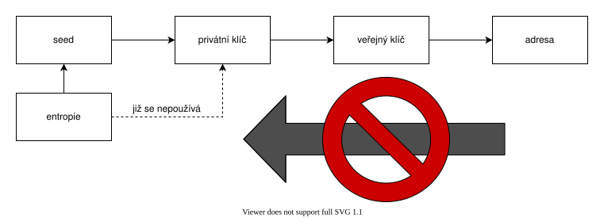

  Je to <a href="#hash">zahashovaný</a> (funkcí
  SHA256 a následně ještě RIPEMD160) veřejný klíč, případně skript,
  případně nově u
  <a href="#taproot">taprootu</a> samotný veřejný
  klíč, ve prospěch kterého budou bitcoiny uzamčeny. V minulosti bývala
  zakódovaná v Base58Check, poslední standard využívá kódování Bech32(m)
  se sofistikovanější ochranou před překlepy. K vygenerování adresy není
  nutná komunikace se sítí, lze ji vygenerovat offline. Nutný je pouze
  zdroj entropie (případně již pomocí kvalitní entropie vygenerovaný
  <a href="#seed">seed</a>).

  <figure>
    
    <figcaption>
      Na počátku je náhoda, na konci adresa. Vracet se však nelze.
    </figcaption>
  </figure>

  U adresy vygenerováné standardní cestou s dostatkem počáteční entropie
  je prakticky vyloučeno (teoretická pravděpodobnost je nepředstavitelně
  nízká), že by již byla někdy vygenerována. Dřív objevíte trpaslíka
  uprostřed černé díry, jak hledá s baterkou vypínač, než aby se vám
  podařilo z kvalitní entropie vygenerovat již dříve vygenerovanou
  adresu.

<h3>Příklady různých adres:</h3>

  <table>
    <thead>
      <tr>
        <th>typ</th>
        <th>označení</th>
        <th>adresa</th>
        <th>kódování</th>
      </tr>
    </thead>
    <tbody>
      <tr>
        <td>p2pkh</td>
        <td>legacy</td>
        <td class="long2">1GRYfroBCL6wJeggD92VdPvJp5vKaVtsrA</td>
        <td>Base58Check s počáteční 1</td>
      </tr>
      <tr>
        <td>p2sh</td>
        <td>nested segwit</td>
        <td class="long2">39qmkmoB1t1mjGAowURRimoQduubbhVoZz</td>
        <td>Base58Check s počáteční 3</td>
      </tr>
      <tr>
        <td>p2wpkh</td>
        <td>native segwit</td>
        <td class="long2">
          bc1ql0t4gka0j9084nz0zrs9sc9tqtf0w29rdh503g
        </td>
        <td>Bech32 s počátečním bc1</td>
      </tr>
      <tr>
        <td>p2tr</td>
        <td>taproot</td>
        <td class="long2">
          bc1pr8pk6n4xvnnejnqpd4mxdezms8scn5zjnrw9duxt62x0fdyk8tpqmmdxnt
        </td>
        <td>Bech32m s počátečním bc1</td>
      </tr>
    </tbody>
  </table>

  <figure>
    
    <figcaption>QR kód bitcoinové adresy</figcaption>
  </figure>

